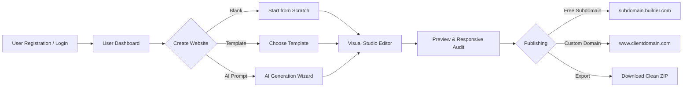
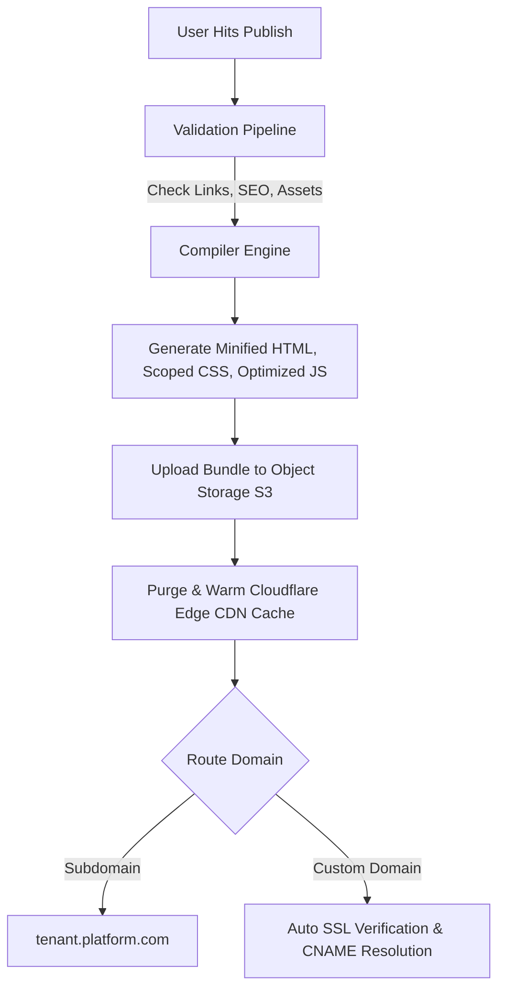
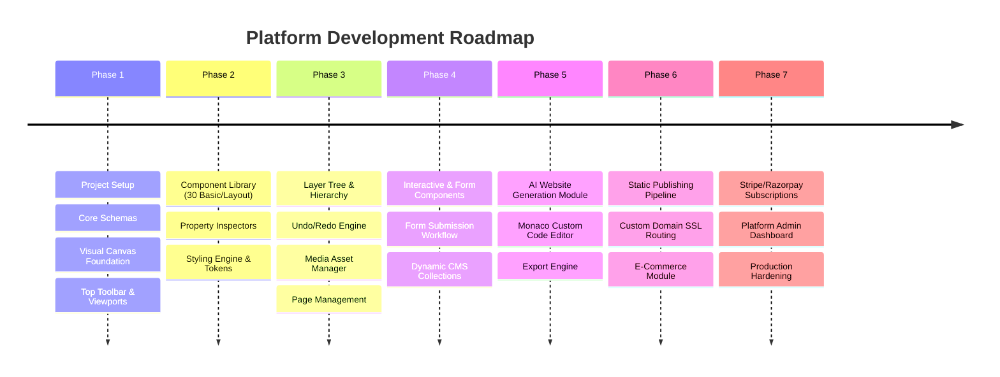

# Complete Product Development Plan – No-Code Website Builder Platform

> **Project Name:** No-Code Visual Website Builder SaaS Platform  
> **Architecture:** Full-stack SaaS · Modular Monolith (Backend) + React/Next.js (Frontend) · AI-Ready  
> **Target Audience:** Non-technical creators, agencies, freelancers, businesses, and developers needing rapid web development.

---

## 1. Product Vision & Scope

### 1.1 Executive Summary
The platform is a professional SaaS No-Code Website Builder combining visual power with developer flexibility. It synthesizes the core strengths of industry leaders:
- **Webflow:** Advanced visual design, CSS-level controls, responsive breakpoints, class styling.
- **Wix:** Accessible, beginner-friendly onboarding, rich ready-made section library.
- **Elementor:** Intuitive drag-and-drop mechanics with reusable layout widgets.
- **Figma:** Precision canvas controls, layer tree, auto-layout, alignment guides, design tokens.
- **Framer:** Fluid micro-interactions, responsive flex layouts, modern animation presets.
- **Shopify:** Robust e-commerce catalogs, checkout management, inventory, cart workflows.

The platform produces clean, standards-compliant output for everything from personal portfolios to enterprise marketing sites, blogs, and multi-tenant dynamic applications.

---

### 1.2 End-to-End User Journey



1. **Onboarding & Auth:** Sign up via email/password or OAuth (Google), onboarding survey.
2. **Dashboard:** Manage existing projects, view templates, monitor analytics, domain status.
3. **Creation Flow:**
   - **Blank Project:** Clean canvas with default theme tokens.
   - **Template Library:** Industry-tailored, multi-page designs.
   - **AI Generation:** Natural-language prompt converted directly into platform JSON component tree.
4. **Visual Editing:** Drag-and-drop canvas, responsive breakpoint styling, rich property controls, layer tree, CMS binding.
5. **Publishing / Deployment:**
   - One-click static deployment to global Edge CDN via S3.
   - Dynamic tenant execution for dynamic blogs, forms, and e-commerce.
   - Custom domains with auto-provisioned SSL.
   - Clean export (HTML/CSS/JS or Next.js bundle).

---

### 1.3 Supported Website Categories & Verticals

| Category | Typical Use Cases & Required Blocks |
| :--- | :--- |
| **Business / Corporate** | Hero, Value Proposition, Services, Case Studies, Team, Clients, Contact, Lead Capture |
| **Personal / Portfolio** | Projects Grid, Resume/Bio, Case Study Details, Socials, Testimonials, Contact Form |
| **E-commerce** | Catalog, Product Details, Cart Drawer, Checkout, Filter & Search, Order Tracking |
| **Education & Courses** | Course Catalog, Curriculum Accordion, Pricing Tiers, Instructors, Enroll CTA |
| **Food & Hospitality** | Menu Display, Table Reservation Form, Photo Gallery, Location/Hours, Reviews |
| **Real Estate** | Property Listings, Filter by Price/Location, Virtual Tour Embed, Agent Inquiry Form |
| **Healthcare & Clinics** | Doctor Profiles, Services, Appointment Booking Form, Trust Badges, Emergency Contact |
| **Blogging & Editorial** | Featured Post Hero, Category Filters, Rich Text Article Reader, Author Box, Comments |
| **SaaS & Tech** | Feature Walkthrough, Product Interactive Demos, Pricing Comparison Matrix, Integrations Grid |
| **Events & Conferences** | Speaker Lineup, Agenda Timeline, Ticket Tiers, Venue Map, Registration Form |
| **Travel & Tourism** | Tour Packages, Destination Guides, Booking Form, Itinerary Breakdown, Reviews |
| **Dynamic Web Portals** | User Auth, Dynamic Record Feeds, Client Dashboards, Protected Pages |

---

## 2. Technology Stack & Architecture

### 2.1 Technology Matrix

| Layer | Technology | Justification & Purpose |
| :--- | :--- | :--- |
| **Frontend Framework** | **Next.js 14+ (App Router) + React 18/19** | Hybrid SSR/SSG for dashboard & marketing; dynamic client rendering for visual canvas |
| **Language** | **TypeScript 5+** | Full type safety across component schemas, state transitions, and API contracts |
| **Styling** | **Tailwind CSS + CSS Modules** | Utility-first styling for platform UI; CSS variables for dynamic user site rendering |
| **UI Component Library** | **shadcn/ui + Radix UI** | Accessible, unstyled primitives for modals, dropdowns, tooltips, dialogs |
| **Iconography** | **Lucide React** | Consistent, lightweight vector icons |
| **Drag and Drop Engine** | **dnd-kit + Craft.js Foundation** | Accessible drag-and-drop primitives, extensible component canvas tree |
| **Code Editor** | **Monaco Editor** | Industry-standard in-browser code editor for custom CSS/JS, HTML embeds |
| **State Management** | **Zustand + Immer** | Immutable tree updates, lightweight editor state, undo/redo history stacks |
| **Backend Core** | **Python 3.12 + Django 5** | Robust enterprise ORM, mature authentication, security, and administrative framework |
| **API Layer** | **Django REST Framework (DRF)** | Standardized RESTful endpoints, serializers, permissions, pagination |
| **Database** | **PostgreSQL 16** | Relational integrity for users, sites, JSONB storage for flexible page component schemas |
| **Task Queue & Cache** | **Redis 7 + Celery** | Asynchronous site generation, publishing pipeline, AI job batching, caching |
| **Object Storage** | **AWS S3 / Cloudinary** | Asset library, media uploads, static compiled site bundle hosting |
| **Edge & CDN** | **Cloudflare / AWS CloudFront** | Fast global distribution, DDoS protection, edge routing for custom domains |
| **AI Integration** | **OpenAI API / Gemini API** | Natural language to page schema generation, AI text/image/SEO assistance |
| **Payments** | **Stripe / Razorpay** | Tiered subscription billing, metered AI credits, tenant checkout processing |
| **Monitoring & Telemetry** | **Sentry + PostHog** | End-to-end exception tracking and platform product analytics |

### 2.2 Core Architectural Principles
1. **Decoupled Editor & Backend:** Django handles business logic, auth, storage, and publishing orchestration. React/Next.js manages high-performance canvas rendering.
2. **JSON Tree as Single Source of Truth:** Pages are modeled as declarative JSON trees. The canvas renders this tree interactively; the compiler converts this exact tree into optimized static HTML/CSS or dynamic SSR runtime.
3. **No Raw HTML Execution in Main Context:** User-injected scripts or custom HTML execute inside sandboxed `<iframe>` instances to prevent XSS and platform tampering.
4. **Document Flow over Absolute Positioning:** Layouts default to standard Flexbox and CSS Grid to guarantee responsive stability across all viewports.

---

## 3. Frontend Application Structure

```
frontend/
├── public/
│   ├── fonts/
│   ├── icons/
│   └── images/
├── src/
│   ├── app/
│   │   ├── (auth)/
│   │   │   ├── login/
│   │   │   ├── register/
│   │   │   ├── forgot-password/
│   │   │   └── reset-password/
│   │   ├── (dashboard)/
│   │   │   ├── dashboard/
│   │   │   ├── websites/
│   │   │   ├── templates/
│   │   │   ├── settings/
│   │   │   └── billing/
│   │   ├── editor/
│   │   │   └── [websiteId]/
│   │   │       ├── page.tsx
│   │   │       └── layout.tsx
│   │   ├── preview/
│   │   │   └── [websiteId]/
│   │   └── api/
│   ├── components/
│   │   ├── ui/                    # Base primitives (shadcn)
│   │   ├── dashboard/             # Dashboard cards, website grids
│   │   ├── navigation/            # Topbars, sidebars
│   │   └── editor/
│   │       ├── toolbar/           # Top actions, viewports, undo/redo
│   │       ├── canvas/            # Rulers, guides, viewport frame, selection box
│   │       ├── sidebar-left/      # Elements catalog, layers tree, pages, assets
│   │       ├── sidebar-right/     # Design panel, style tabs, typography, spacing
│   │       ├── layers-panel/      # Tree view with drag reordering, lock, hide
│   │       ├── properties/        # Dynamic schema inspector
│   │       ├── code-editor/       # Monaco custom code modals
│   │       └── ai-assistant/      # Prompt bar & generation wizards
│   ├── builder-components/        # 100+ Visual Registry Elements
│   │   ├── basic/                 # Heading, Text, Button, Image, Icon, Divider
│   │   ├── layout/                # Section, Container, Flex, Grid, Split, Columns
│   │   ├── navigation/            # Navbar, MegaMenu, MobileDrawer, Breadcrumbs
│   │   ├── interactive/           # Accordion, Tabs, Modal, Carousel, Slider
│   │   ├── forms/                 # Input, Select, Textarea, Radio, Checkbox, Form
│   │   ├── business/              # Hero, Features, PricingTable, Testimonial, FAQ
│   │   ├── ecommerce/             # ProductCard, Cart, ProductGallery, Pricing
│   │   └── media/                 # Video, Audio, Embeds, GoogleMaps, Social
│   ├── hooks/                     # useEditorState, useShortcuts, useHistory
│   ├── stores/                    # Zustand stores (editorStore, uiStore, cmsStore)
│   ├── types/                     # ComponentSchema, PageTree, BreakpointTypes
│   ├── utils/                     # CSS generators, compiler, tree manipulation
│   └── constants/                 # Default tokens, breakpoint presets
└── package.json
```

---

## 4. Drag-and-Drop Editor Engine

### 4.1 Tree-Based Component Hierarchy Schema
Every element is modeled as a deterministic node in a normalized tree:

```typescript
export type Breakpoint = 'mobile' | 'tablet' | 'desktop' | 'wide';

export interface ComponentStyle {
  // Box Model
  display?: 'block' | 'flex' | 'grid' | 'none' | 'inline-block';
  flexDirection?: 'row' | 'column' | 'row-reverse' | 'column-reverse';
  justifyContent?: string;
  alignItems?: string;
  gridTemplateColumns?: string;
  gap?: string;
  width?: string;
  maxWidth?: string;
  minWidth?: string;
  height?: string;
  maxHeight?: string;
  minHeight?: string;
  padding?: { top?: string; right?: string; bottom?: string; left?: string };
  margin?: { top?: string; right?: string; bottom?: string; left?: string };

  // Typography
  fontFamily?: string;
  fontSize?: string;
  fontWeight?: string;
  lineHeight?: string;
  letterSpacing?: string;
  textAlign?: 'left' | 'center' | 'right' | 'justify';
  color?: string;

  // Background & Borders
  backgroundColor?: string;
  backgroundImage?: string;
  backgroundSize?: string;
  borderRadius?: string;
  borderWidth?: string;
  borderColor?: string;
  borderStyle?: string;

  // Effects & Positioning
  boxShadow?: string;
  opacity?: number;
  position?: 'relative' | 'absolute' | 'fixed' | 'sticky';
  top?: string;
  bottom?: string;
  left?: string;
  right?: string;
  zIndex?: number;
  overflow?: 'visible' | 'hidden' | 'scroll' | 'auto';
}

export interface ComponentNode {
  id: string;
  type: string;                      // e.g., 'Button', 'Section', 'Hero'
  parentId: string | null;
  children: string[];                // Ordered child IDs
  props: Record<string, any>;        // Text content, image src, link URL, etc.
  styles: {
    base: ComponentStyle;
    responsive?: Partial<Record<Breakpoint, Partial<ComponentStyle>>>;
    hover?: Partial<ComponentStyle>;
    focus?: Partial<ComponentStyle>;
  };
  animations?: {
    type?: string;
    trigger?: 'load' | 'scroll' | 'hover' | 'click';
    duration?: number;
    delay?: number;
    easing?: string;
  };
  visibility?: {
    mobile?: boolean;
    tablet?: boolean;
    desktop?: boolean;
  };
  customAttributes?: Record<string, string>;
  locked?: boolean;
  hidden?: boolean;
  name?: string;                     // Human-readable layer label
}

export interface PageDocument {
  id: string;
  title: string;
  slug: string;
  seo: {
    metaTitle?: string;
    metaDescription?: string;
    ogImage?: string;
    canonical?: string;
  };
  rootNodeId: string;
  nodes: Record<string, ComponentNode>;
}
```

### 4.2 Canvas Mechanics
- **Direct Manipulation:** Selection borders, resize handles on 8 cardinal points, drag handles.
- **Rulers & Smart Alignment Guides:** Real-time distance measurement to siblings and parents, snap-to-grid (8px/4px increments).
- **Infinite Navigation:** Canvas zoom (25% to 200%), keyboard space-drag panning.
- **Context Menus:** Right-click element to copy, paste, duplicate, convert to component, delete, or inspect JSON.
- **Keyboard Shortcuts Map:**
  - `Ctrl / Cmd + Z`: Undo
  - `Ctrl / Cmd + Shift + Z` / `Ctrl + Y`: Redo
  - `Ctrl / Cmd + C`: Copy node
  - `Ctrl / Cmd + V`: Paste node
  - `Ctrl / Cmd + D`: Duplicate node
  - `Delete` / `Backspace`: Remove selected node
  - `Ctrl / Cmd + S`: Save checkpoint
  - `Esc`: Deselect / Traverse to parent node
  - `Arrow Keys`: Nudge position / margin (Shift + Arrow for 10px increments)

---

## 5. Comprehensive Component Library (Target: 100+ Components)

1. **Basic:** Heading (H1-H6), Paragraph, Rich Text, Image, Video, Button, Link, Icon, Divider, Spacer, Container, HTML Embed, Code Snippet.
2. **Layout Primitives:** Section, Box/Container, Flex Container, CSS Grid (1-12 col), 2/3/4 Column Split, Card Container, Sticky Header/Footer, Sidebar Layout.
3. **Navigation:** Standard Header, Transparent Overlay Nav, Sticky Nav, Dropdown Nav, Mega Menu, Hamburger Mobile Menu, Breadcrumbs, Pagination, Footer.
4. **Interactive:** Accordion (FAQ), Tabbed Content, Modal / Dialog Popup, Banner Notification, Carousel Slider, Image Lightbox, Tooltip, Progress Bar, Countdown Timer, Pricing Switcher (Monthly/Annual).
5. **Form Controls:** Text Input, Email Input, Password Input, Textarea, Dropdown Select, Radio Group, Checkbox, Toggle Switch, Date/Time Picker, File Upload Dropzone, Submit Button, reCAPTCHA / Cloudflare Turnstile token container.
6. **Pre-Built Business Sections:**
   - Hero: Centered Hero, Split Hero with Image, Hero with Video Background, Minimal Hero.
   - Social Proof: Logo Clouds, Review Cards, Metric Counters, Testimonial Sliders.
   - Conversion: Pricing Comparison Matrix, Call-To-Action Banners, Newsletter Subscribe Bar.
   - Information: Features Grid, About Us Timeline, Team Showcase, FAQ Accordion, Contact Section with Map.
7. **E-Commerce Elements:** Product Card, Product Image Gallery with Zoom, Add to Cart Button, Quantity Counter, Mini-Cart Drawer, Price Display with Discount Badge, Stock Status Indicator, Reviews Summary.
8. **Media & Embeds:** Responsive Image with WebP/AVIF fallback, Video Player (HLS/MP4), YouTube/Vimeo embed, Spotify/Podcast embed, Google Maps interactive embed, Social Share buttons.

---

## 6. Global Design System & Theming Engine

- **Tokens Hierarchy:**
  - **Color Palette:** Primary, Secondary, Accent, Background, Surface, Muted, Danger, Success, Border.
  - **Typography Scale:** Base font family, Heading font family, Modular scale ratio (1.25, 1.333, etc.), weights, line-height presets.
  - **Spacing Tokens:** 4px grid steps (`space-1` to `space-24`).
  - **Radius & Shadows:** Flat, Subtle, Medium, Elevated, Floating; pill radius to sharp corners.
- **Dynamic Token Cascade:** Changing the Primary Theme Color automatically recalculates CSS variables and updates all connected components across all pages in real-time.
- **Font Support:** Seamless integration with 1,500+ Google Fonts + custom WOFF2 font uploader with font-display swap optimization.

---

## 7. Responsive Design System

- **Preset Viewport Breakpoints:**
  - Mobile: `375px`
  - Large Mobile: `480px`
  - Tablet: `768px`
  - Laptop: `1024px`
  - Desktop: `1440px` (Default Base)
  - Ultra-Wide: `1920px`
- **Responsive Cascade Strategy:** Mobile-first or Desktop-down override inheritance. Sub-breakpoint modifications store delta diffs only, ensuring light JSON payloads and clean maintenance.
- **Device-Specific Visibility:** Direct toggle to show/hide elements per viewport breakpoint (e.g., desktop menu vs. mobile drawer).

---

## 8. Dynamic CMS & Data Binding

- **Collections Builder:** Define schema with fields: Text, Rich Text, Markdown, Image, Number, Date, Boolean, Reference (foreign key), File, Slug.
- **Dynamic Data Binding:** Connect any visual canvas element's props (e.g., Heading text, Image src) to a CMS field path (`{{ post.title }}`, `{{ post.featured_image }}`).
- **Repeaters & List Renderers:** Bind containers to CMS collections to automatically generate dynamic grids with pagination and category filtering.
- **Dynamic Route Templates:** Single template page (e.g., `/blog/[slug]`) automatically generates all individual post pages upon publishing.

---

## 9. E-Commerce Core Module

- **Product & Inventory Engine:** SKU, pricing, sale prices, tiered variants (size, color, material), stock levels, out-of-stock actions.
- **Cart & State:** Client-side cart store synchronized with session and server-side checkout validation.
- **Checkout & Gateways:**
  - Integrated Razorpay / Cashfree for India.
  - Integrated Stripe for global currency transactions.
  - Secure webhook listener updating orders, invoices, and automated transactional customer emails.

---

## 10. AI Website Generation Engine

- **Structured Output Architecture:** Prompts do not output raw HTML. Prompts query LLM with strict JSON schema definitions matching `ComponentNode` trees.
- **Capabilities:**
  1. *Prompt to Website:* Generates site structure, brand colors, typography, pages, and rich styled components.
  2. *Section Generation:* Generate a single section (e.g., "Add an enterprise pricing table with 3 tiers").
  3. *AI Copywriting & Redesign:* In-editor rewriting, tone adjustment, SEO meta generation, image generation via DALL-E / Imagen.
  4. *Responsive Fixer:* AI audit detecting overflowing containers, poor contrast ratios, or missing alt tags.
- **Token Tracking & Safety:** Usage quotas per user plan, prompt validation, and rollback capability.

---

## 11. Publishing & Edge Infrastructure



- **Static Generation:** Instant load times, zero server cost per static visitor, extreme security.
- **Dynamic Routing:** API proxying for forms, CMS queries, cart, and authentication without running separate servers per tenant.
- **Code Export:** 1-click download of a self-contained production bundle (HTML/CSS/JS or Next.js app) with clean code and no platform lock-in.

---

## 12. Security, Authentication & Role-Based Permissions

- **Authentication:** Django Authentication + DRF SimpleJWT (Access/Refresh tokens) + Social OAuth (Google).
- **Access Control Roles:**
  - `Owner`: Full access, billing, domain delegation, site deletion.
  - `Admin`: Manage pages, publish, edit CMS, invite members.
  - `Editor`: Edit canvas content, update assets, modify draft states.
  - `Viewer`: Read-only preview links with commenting capability.
- **Sandbox Security:** Strict Content Security Policy (CSP), custom customer scripts executed exclusively in sandboxed preview iframes.

---

## 13. Backend Architecture & Django Monolith Project Layout

```
backend/
├── config/
│   ├── settings/
│   │   ├── base.py
│   │   ├── development.py
│   │   └── production.py
│   ├── asgi.py
│   ├── wsgi.py
│   ├── celery.py
│   └── urls.py
├── apps/
│   ├── authentication/       # JWT auth, user registration, social login
│   ├── accounts/             # User profiles, passwords, settings
│   ├── organizations/        # Teams, role memberships, invitations
│   ├── websites/             # Site entity, domains, SEO, global tokens
│   ├── pages/                # Page entities, versioning, JSON component tree
│   ├── components/           # System component definitions & custom blocks
│   ├── templates/            # Public template marketplace & user templates
│   ├── assets/               # Media storage, upload presign, image optimization
│   ├── cms/                  # Collections, schemas, dynamic item records
│   ├── ecommerce/            # Products, variants, orders, checkouts
│   ├── forms/                # Form schemas, submissions, email triggers, webhooks
│   ├── ai_generator/         # LLM prompt orchestration, JSON tree synthesis
│   ├── publishing/           # Compiler, S3 bundle uploader, CDN invalidation
│   ├── billing/              # Subscriptions, Stripe/Razorpay webhooks, invoices
│   ├── analytics/            # Pageviews, visitors, traffic breakdown
│   └── admin_portal/         # Platform admin oversight, abuse monitoring
├── manage.py
├── requirements/
│   ├── base.txt
│   ├── local.txt
│   └── production.txt
└── Dockerfile
```

---

## 14. Phased Implementation Roadmap



---

## 15. Tracking Files Setup
- **`Plan.md`**: Master blueprint and requirement specification (this file).
- **`features.md`**: Live tracker of all newly created or planned features.
- **`bugs.md`**: Live tracker of bug reports, reproduction steps, severity, and resolutions.

